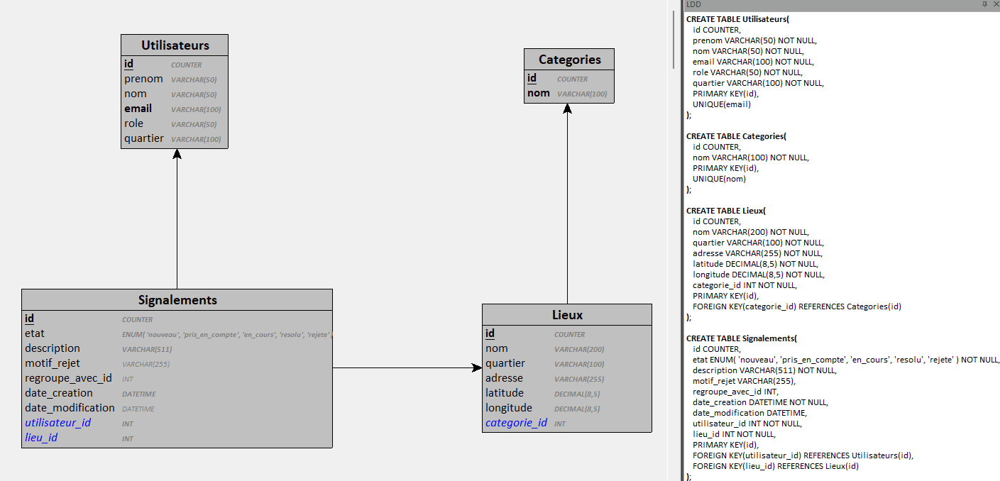

# RueNet — Service de signalements citoyens

> Application web Django de gestion : un **service de signalements citoyens** dont le **catalogue** est fait d'**équipements de la ville** (les *lieux*) et dont les **demandes** sont des **signalements**.

Projet de groupe réalisé dans le cadre du brief « Application de gestion avec Django » (3 personnes, 10 jours).

---

## Sommaire

1. [Présentation](#présentation)
2. [Fonctionnalités](#fonctionnalités)
3. [Stack technique](#stack-technique)
4. [Architecture du projet](#architecture-du-projet)
5. [Modèle de données](#modèle-de-données)
6. [Cycle de vie d'un signalement](#cycle-de-vie-dun-signalement)
7. [Rôles et droits d'accès](#rôles-et-droits-daccès)
8. [Installation](#installation)
9. [Fichiers statiques et `DEBUG=False` (WhiteNoise)](#fichiers-statiques-et-debugfalse-whitenoise)
10. [Lancer le projet](#lancer-le-projet)
11. [Import des données](#import-des-données)
12. [Choix techniques](#choix-techniques)
13. [Organisation du travail (Git)](#organisation-du-travail-git)
14. [Tests](#tests)
15. [Équipe](#équipe)
16. [Pistes d'amélioration](#pistes-damélioration)

---

## Présentation

Le brief s'articule autour de deux notions :

| Notion du brief | Dans RueNet |
|---|---|
| **Catalogue** | Les **lieux** : équipements de la ville, classés par catégorie et par quartier, avec adresse et coordonnées GPS |
| **Demande** | Les **signalements** déposés par les utilisateurs sur un lieu |

Un utilisateur parcourt le catalogue des équipements et signale un problème sur l'un d'eux. Un gestionnaire (agent de la ville) traite ensuite le signalement en le faisant avancer dans un cycle de vie encadré : prise en compte, traitement, résolution ou rejet motivé.

## Fonctionnalités

**Pages publiques**
- Page d'accueil avec le logo du service
- **Catalogue** des lieux, triés par nom, avec **recherche par mot-clé** (nom, adresse ou quartier) et **filtre par catégorie**, combinables
- Page de détail d'un lieu (catégorie, quartier, adresse, coordonnées GPS)

**Comptes**
- Inscription (e-mail, prénom, nom, quartier, mot de passe), avec connexion automatique à la création du compte
- Connexion par **adresse e-mail** ; déconnexion (formulaire POST protégé par le jeton CSRF)
- Barre de navigation commune qui s'adapte au visiteur : anonyme, utilisateur ou gestionnaire

**Utilisateur (rôle `utilisateur`)**
- Dépôt d'un signalement depuis la page d'un lieu (`/catalogue/<id>/demande/`) ou depuis la page « Faire un signalement » (`/signalement/nouveau/`) en choisissant le lieu
- Page **Mes demandes** : liste de ses propres signalements avec leur état (consultation seule)

**Gestionnaire (rôle `gestionnaire`)**
- Liste de tous les signalements, **filtrable** par mot-clé, état et catégorie
- Page de détail d'un signalement avec changement d'état selon les **transitions autorisées** uniquement
- **Rejet motivé** : le motif est obligatoire pour passer un signalement à l'état « rejeté »
- Affichage des signalements **rattachés** à un signalement principal (doublons chargés depuis les données)
- Administration des catégories, lieux, signalements et utilisateurs via l'admin Django

**Transverse**
- Messages de confirmation en haut de page
- Page d'erreur **403 personnalisée** (`templates/403.html`)
- Fichiers statiques servis avec `DEBUG=False` grâce à WhiteNoise

## Stack technique

- **Python** 3.12+ (requis par Django 6)
- **Django** 6.1, **SQLite**
- **python-dotenv** pour les variables d'environnement (`.env`)
- **WhiteNoise** pour servir les fichiers statiques quand `DEBUG=False`
- Interface en **français** (`fr-fr`), fuseau **Europe/Paris**
- **Templates Django** (HTML) avec **Tailwind CSS** chargé via le CDN (`cdn.tailwindcss.com`) : une connexion internet est nécessaire, et ce mode est prévu pour le développement
- **Git / GitHub**

## Architecture du projet

Le projet Django s'appelle **RueNet** et contient deux applications. Le dossier `RueNet/` de premier niveau est celui qui contient `manage.py`.

```
Brief_Django/
├── README.md
├── requirements.txt
├── .gitignore
├── doc/                                 # Schémas de la base (MCD et MLD)
│   ├── Brief_Django_Diagramme_MCD_(EA).png
│   └── Brief_Django_Diagramme_MLD.png
└── RueNet/                              # Dossier du projet Django (là où se trouve manage.py)
    ├── manage.py
    ├── .env                             # Variables d'environnement (non versionné)
    ├── donnees/signalements/            # Fichiers CSV du thème (non versionnés, voir plus bas)
    ├── RueNet/                          # Configuration : settings.py, urls.py, wsgi.py, asgi.py
    ├── comptes/                         # App « comptes » : utilisateurs et authentification
    │   ├── models.py                    #   Utilisateur (AbstractUser + role + quartier)
    │   ├── forms.py                     #   FormulaireInscription
    │   ├── views.py                     #   VueInscription, VueConnexion, VueDeconnexion, RoleRequisMixin
    │   ├── urls.py                      #   app_name = "comptes"
    │   ├── admin.py
    │   ├── migrations/
    │   └── templates/comptes/           #   inscription.html, connexion.html
    ├── signalement/                     # App « signalement » : cœur métier
    │   ├── models.py                    #   Categorie, Lieu, Signalement
    │   ├── forms.py                     #   formulaires de dépôt et de gestion
    │   ├── views.py                     #   catalogue, dépôt, « Mes demandes », gestion
    │   ├── urls.py                      #   app_name = "signalement"
    │   ├── admin.py
    │   ├── migrations/
    │   ├── management/commands/         #   charger_donnees.py (import des CSV)
    │   └── templates/                   #   catalogue/, gestion/, signalement/
    ├── templates/                       # base.html (gabarit commun), main.html (accueil), 403.html
    ├── static/images/                   # Logo et image de fond
    └── staticfiles/                     # Généré par collectstatic (non versionné)
```

| App | Responsabilité |
|---|---|
| `comptes` | Modèle `Utilisateur` personnalisé (`AUTH_USER_MODEL`) avec rôle et quartier, inscription, connexion, déconnexion, contrôle d'accès par rôle |
| `signalement` | Modèles `Categorie`, `Lieu`, `Signalement`, catalogue (liste avec recherche et filtre, détail), dépôt de signalement, « Mes demandes » et gestion |

## Modèle de données

### Schéma conceptuel (MCD)

Un utilisateur émet 0 à n signalements, un lieu est visé par 0 à n signalements, une catégorie regroupe 0 à n lieux.

<p align="center">
  
</p>

### Schéma logique (MLD)

<p align="center">
  
</p>

> Dans Django, le modèle `Utilisateur` hérite aussi des champs d'`AbstractUser` (mot de passe **haché**, dates de connexion, droits d'accès à l'admin, etc.). Ils n'apparaissent pas sur les schémas.

```
Categorie ──< Lieu ──< Signalement >── Utilisateur (comptes)
                           │
                           └── regroupe_avec ──> Signalement (auto-référence)
```

### `Utilisateur` (app `comptes`)

Modèle utilisateur personnalisé, qui hérite de `AbstractUser`. **L'adresse e-mail est l'identifiant de connexion** (`USERNAME_FIELD = "email"`).

| Champ | Type | Description |
|---|---|---|
| `email` | `EmailField(100)` | Adresse e-mail, **unique**, sert de nom d'utilisateur |
| `role` | `CharField(20)` | `utilisateur` (par défaut) ou `gestionnaire` |
| `quartier` | `CharField(100)` | Quartier de résidence (facultatif) |

Le modèle expose aussi deux alias de lecture et d'écriture : `prenom` (→ `first_name`) et `nom` (→ `last_name`).

### `Categorie`

| Champ | Type | Description |
|---|---|---|
| `nom` | `CharField(100)` | Nom de la catégorie (tri alphabétique) |

### `Lieu` (le catalogue)

| Champ | Type | Description |
|---|---|---|
| `nom` | `CharField(200)` | Nom de l'équipement |
| `categorie` | `ForeignKey(Categorie)` | Catégorie (`PROTECT` : impossible de supprimer une catégorie utilisée) |
| `quartier` | `CharField(100)` | Quartier |
| `adresse` | `CharField(255)` | Adresse |
| `latitude` | `FloatField` | Coordonnée GPS |
| `longitude` | `FloatField` | Coordonnée GPS |

### `Signalement` (la demande)

| Champ | Type | Description |
|---|---|---|
| `utilisateur` | `ForeignKey(AUTH_USER_MODEL)` | Auteur (`CASCADE`) |
| `lieu` | `ForeignKey(Lieu)` | Équipement concerné (`PROTECT`) |
| `etat` | `CharField(20)` | État courant (voir ci-dessous), `nouveau` par défaut |
| `description` | `TextField` | Description du problème |
| `motif_rejet` | `TextField` | Renseigné en cas de rejet (vide sinon) |
| `regroupe_avec` | `ForeignKey("self")` | Signalement principal en cas de doublon (`SET_NULL`) |
| `date_creation` | `DateTimeField` | Date de création (conservée depuis le CSV, pas d'`auto_now`) |
| `date_modification` | `DateTimeField` | Date de dernière modification (mise à jour par la vue de gestion) |

## Cycle de vie d'un signalement

Cinq états, avec des transitions strictement contrôlées (constante `Signalement.TRANSITIONS`) :

```
                ┌──────────────► Rejeté
                │                  ▲
Nouveau ──► Pris en compte ──► En cours ──► Résolu
   │                │
   └────────────────┘ (rejet possible)
```

| État actuel | Transitions autorisées |
|---|---|
| `nouveau` | `pris_en_compte`, `rejete` |
| `pris_en_compte` | `en_cours`, `rejete` |
| `en_cours` | `resolu` |
| `resolu` | — (état final) |
| `rejete` | — (état final) |

Le formulaire de gestion ne propose que l'état courant et les états autorisés ; une valeur forgée à la main est donc refusée par la validation côté serveur. Un rejet sans `motif_rejet` est refusé avec un message d'erreur.

## Rôles et droits d'accès

Le contrôle est fait **côté serveur** par le mixin `RoleRequisMixin` (`comptes/views.py`), pas seulement en masquant des liens.

| Page | Visiteur anonyme | Utilisateur | Gestionnaire |
|---|---|---|---|
| Accueil, catalogue, détail d'un lieu | ✅ | ✅ | ✅ |
| Inscription, connexion | ✅ | ✅ (redirigé vers le catalogue) | ✅ |
| Dépôt de signalement, « Mes demandes » | ❌ 403 | ✅ | ❌ 403 |
| Gestion (`/gestion/…`) | ❌ 403 | ❌ 403 | ✅ |

Un accès refusé affiche la page 403 personnalisée, avec un message qui précise le rôle attendu.

## Installation

### Prérequis

- Python 3.12 ou plus récent (requis par Django 6)
- Git

### 1. Cloner le dépôt

```bash
git clone https://github.com/clov0202/Brief_Django.git
cd Brief_Django
```

### 2. Environnement virtuel

**Linux / macOS**
```bash
python3 -m venv .venv
source .venv/bin/activate
```

**Windows (PowerShell)**
```powershell
python -m venv .venv
.\.venv\Scripts\Activate.ps1
```

> Si PowerShell bloque l'activation : `Set-ExecutionPolicy -Scope CurrentUser -ExecutionPolicy RemoteSigned`

### 3. Dépendances

```bash
pip install -r requirements.txt
```

Le fichier `requirements.txt` est à la racine du dépôt et contient notamment Django, python-dotenv et **whitenoise** (sans lui, `settings.py` ne démarre pas, car le middleware WhiteNoise est déclaré).

### 4. Variables d'environnement

Crée un fichier `.env` dans le dossier `RueNet/` (à côté de `manage.py`) :

```env
SECRET_KEY=remplace-par-une-longue-cle-secrete
DEBUG=True
DATABASE_NAME=db.sqlite3
```

| Variable | Rôle | Valeur par défaut |
|---|---|---|
| `SECRET_KEY` | Clé secrète Django | `default_secret_key` (**à ne jamais utiliser en production**) |
| `DEBUG` | Mode debug (`True` ou `False`) | `True` |
| `DATABASE_NAME` | Chemin de la base SQLite | `db.sqlite3` dans `RueNet/` |

> Le fichier `.env` ne doit **jamais** être committé : il figure dans `.gitignore`.

`ALLOWED_HOSTS` vaut `localhost` et `127.0.0.1` dans `settings.py`. Pour héberger l'application ailleurs, ajoute le nom de domaine à cette liste.

### 5. Migrations

Le projet utilise un modèle utilisateur personnalisé (`AUTH_USER_MODEL = "comptes.Utilisateur"`, déjà configuré). Ne change pas cette valeur après la première migration.

```bash
cd RueNet
python manage.py migrate
```

> Si tu modifies un modèle, lance d'abord `python manage.py makemigrations`, puis `migrate`.

### 6. Super-utilisateur

```bash
python manage.py createsuperuser
```

> Un super-utilisateur est créé avec le rôle `utilisateur` par défaut. Pour qu'il ait accès à la gestion, ouvre-le dans l'admin (`/admin/`) et passe son **rôle** à *Gestionnaire*. Les comptes gestionnaires se créent aussi depuis l'admin, section « Informations RueNet ».

## Fichiers statiques et `DEBUG=False` (WhiteNoise)

Avec `DEBUG=True`, `runserver` sert lui-même les fichiers statiques. Avec **`DEBUG=False`**, Django ne les sert plus : le CSS de l'administration, le logo et l'image de fond disparaissent. Le projet utilise **WhiteNoise** pour les servir directement depuis l'application, sans serveur web supplémentaire.

**Configuration (déjà en place dans `RueNet/RueNet/settings.py`)**

```python
MIDDLEWARE = [
    'django.middleware.security.SecurityMiddleware',
    'whitenoise.middleware.WhiteNoiseMiddleware',   # juste après SecurityMiddleware
    # ...
]

STATIC_URL = 'static/'
STATICFILES_DIRS = [BASE_DIR / "static"]       # fichiers du projet (logo, image de fond)
STATIC_ROOT = BASE_DIR / "staticfiles"         # destination de collectstatic
```

**Mise en route avec `DEBUG=False`** (depuis le dossier `RueNet/`)

1. Installer WhiteNoise : `pip install whitenoise`. Il est déjà listé dans `requirements.txt`, donc `pip install -r requirements.txt` suffit.
2. Mettre `DEBUG=False` dans le fichier `.env`.
3. Rassembler tous les fichiers statiques (ceux du projet et ceux de l'admin) dans `staticfiles/` :
   ```bash
   python manage.py collectstatic --noinput
   ```
4. Lancer le serveur : `python manage.py runserver`.

À savoir :
- Le dossier `staticfiles/` est **généré** : il n'est pas versionné. Après avoir modifié un fichier dans `static/`, relance `collectstatic` (seulement nécessaire avec `DEBUG=False`).
- Les pages d'erreur (404, 403) personnalisées ne s'affichent qu'avec `DEBUG=False`.
- Tailwind est chargé depuis un CDN : il ne passe pas par les fichiers statiques et fonctionne dans les deux modes.

## Lancer le projet

```bash
cd RueNet
python manage.py runserver
```

| Page | URL | Nom de la route | Accès |
|---|---|---|---|
| Accueil | http://127.0.0.1:8000/ | `accueil` | Public |
| Catalogue des lieux (`?mot_cle=...&categorie=<id>`) | `/catalogue/` | `signalement:liste` | Public |
| Détail d'un lieu | `/catalogue/<id>/` | `signalement:detail` | Public |
| Déposer un signalement sur un lieu | `/catalogue/<id>/demande/` | `signalement:demande` | Utilisateur |
| Faire un signalement (choix du lieu) | `/signalement/nouveau/` | `signalement:nouveau` | Utilisateur |
| Mes demandes | `/mes-demandes/` | `signalement:mes_demandes` | Utilisateur |
| Gestion : liste (`?mot_cle=...&etat=...&categorie=<id>`) | `/gestion/` | `signalement:gestion_liste` | Gestionnaire |
| Gestion : détail et changement d'état | `/gestion/<id>/` | `signalement:gestion_detail` | Gestionnaire |
| Inscription | `/comptes/inscription/` | `comptes:inscription` | Public |
| Connexion | `/comptes/connexion/` | `comptes:connexion` | Public |
| Déconnexion (POST) | `/comptes/deconnexion/` | `comptes:deconnexion` | Connecté |
| Administration | `/admin/` | — | Compte staff |

> Les URL de `comptes` sont préfixées par `/comptes/` ; celles de `signalement` sont à la racine du site (`path("", include("signalement.urls"))`).

## Import des données

Les jeux de données du thème sont quatre fichiers **CSV**, à placer dans **`RueNet/donnees/signalements/`** (à côté de `manage.py`). Le dossier `donnees/` est dans le `.gitignore` : chaque membre du groupe le copie en local, et les fichiers ne sont jamais modifiés.

```bash
cd RueNet
python manage.py charger_donnees
```

| Fichier CSV | Modèle | Ordre |
|---|---|---|
| `utilisateurs.csv` | `Utilisateur` | 1 |
| `categories.csv` | `Categorie` | 2 |
| `objets.csv` | `Lieu` | 3 |
| `actions.csv` | `Signalement` | 4 |

L'ordre respecte les clés étrangères (les tables parentes d'abord). Tout se passe dans une **transaction** : si une ligne est invalide, rien n'est inséré. La commande utilise uniquement l'ORM Django.

**À savoir**
- La commande **vide d'abord les quatre tables**, puis recharge les CSV : elle peut donc être relancée sans doublons. Les comptes sont vidés eux aussi, **y compris les super-utilisateurs** : relance `python manage.py createsuperuser` après l'import.
- Les en-têtes CSV portent les noms des champs du modèle. Pour les clés étrangères, le suffixe `_id` est utilisé (`categorie_id`, `utilisateur_id`, `regroupe_avec_id`) ; la colonne `objet_id` est renommée en `lieu_id`.
- Les colonnes `id` des CSV sont conservées, ce qui permet aux fichiers de se référencer entre eux.
- Une cellule vide d'une colonne `_id` devient `NULL`.
- Les **comptes de démonstration** reçoivent le mot de passe **`demo1234`**, stocké **haché** (`make_password`). Ils se connectent avec leur **adresse e-mail**.
- Les dates des fichiers sont conservées telles quelles (aucun `auto_now` sur les colonnes de dates).

## Choix techniques

| Choix | Justification |
|---|---|
| **Deux applications** (`comptes`, `signalement`) | Les comptes et l'authentification sont indépendants du métier ; le catalogue et les signalements sont étroitement liés (un signalement porte sur un lieu) et restent dans la même app. |
| **Modèle `Utilisateur` personnalisé**, rôle et quartier portés par le compte | Un seul modèle pour l'authentification et les informations propres au thème ; le rôle (`utilisateur` ou `gestionnaire`) pilote tous les droits d'accès. À définir avant la première migration. |
| **E-mail comme identifiant** (`USERNAME_FIELD = "email"`) | Le brief indique que l'e-mail sert de nom d'utilisateur aux comptes de démonstration ; il est donc `unique`. |
| **Transitions d'état centralisées** dans `Signalement.TRANSITIONS` | Une seule source de vérité : le formulaire de gestion n'en propose que les états autorisés, ce qui refuse aussi une requête forgée. |
| **Motif de rejet vérifié dans `clean()`** du formulaire | La règle métier est appliquée côté serveur, jamais seulement dans le HTML. |
| **Contrôle d'accès par `RoleRequisMixin`** | Les pages protégées le sont côté serveur, pour les anonymes comme pour chaque rôle. |
| **Dates sans `auto_now`** | `auto_now` écraserait les dates des CSV ; la date de modification est mise à jour explicitement par la vue de gestion. |
| **ORM uniquement** | Aucune requête SQL écrite à la main, ni dans les vues ni dans la commande de chargement. |
| **Vues basées sur des classes** | Les vues génériques (`ListView`, `DetailView`, `CreateView`, `UpdateView`) évitent de réécrire la logique des listes et des formulaires. |
| **WhiteNoise** pour les fichiers statiques | Permet de tourner avec `DEBUG=False` sans serveur web dédié. |
| **Configuration dans `.env`** | La clé secrète et `DEBUG` ne sont pas dans le dépôt. |

## Organisation du travail (Git)

| Branche | Usage |
|---|---|
| `main` | Version stable |
| `develop` | Branche d'intégration : les fonctionnalités y sont fusionnées par pull request |
| `feat/<nom>`, `fix/<nom>` | Une branche par fonctionnalité ou correction |
| `doc` | Schémas de la base (MCD et MLD, dossier `doc/`) |

```bash
git switch develop
git pull
git switch -c feat/ma-fonctionnalite
git add .
git commit -m "Ajoute ma fonctionnalité"
git push -u origin feat/ma-fonctionnalite
# puis ouvrir une Pull Request vers develop sur GitHub
```

Règles de l'équipe :
- toujours faire `git pull` avant de commencer (surtout en changeant de machine) ;
- messages de commit clairs, un commit par étape terminée ;
- pas de commit direct sur `main` ;
- ne jamais committer `.venv/`, `db.sqlite3`, `.env` ni `staticfiles/` (couverts par `.gitignore`).

## Tests

```bash
cd RueNet
python manage.py test
```

Les fichiers `tests.py` des deux apps sont vides pour l'instant : la vérification se fait pour le moment à la main, en parcourant l'application de l'inscription jusqu'au traitement d'un signalement par un gestionnaire.

## Équipe

- Clovis
- Maxence
- Matisse

## Pistes d'amélioration

- Création de nouveaux regroupements de doublons depuis l'interface de gestion (aujourd'hui, seuls les regroupements des données chargées sont affichés)
- Carte des lieux à partir des coordonnées GPS
- Notification par e-mail à chaque changement d'état
- Tableau de bord de statistiques pour les gestionnaires
- Pagination du catalogue
- Tests automatisés (modèles, transitions d'état, droits d'accès)
- Tailwind compilé à la place du CDN pour la production
